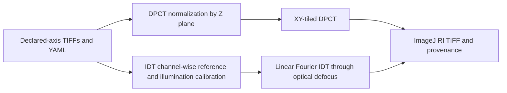
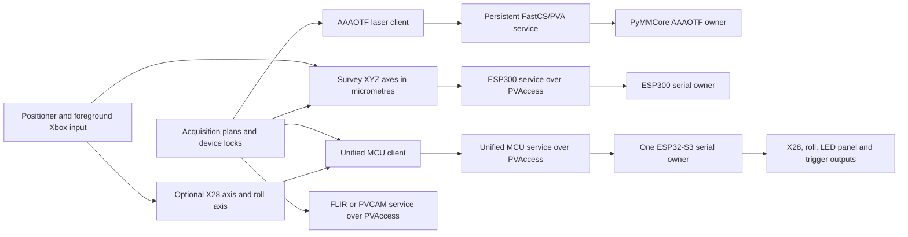
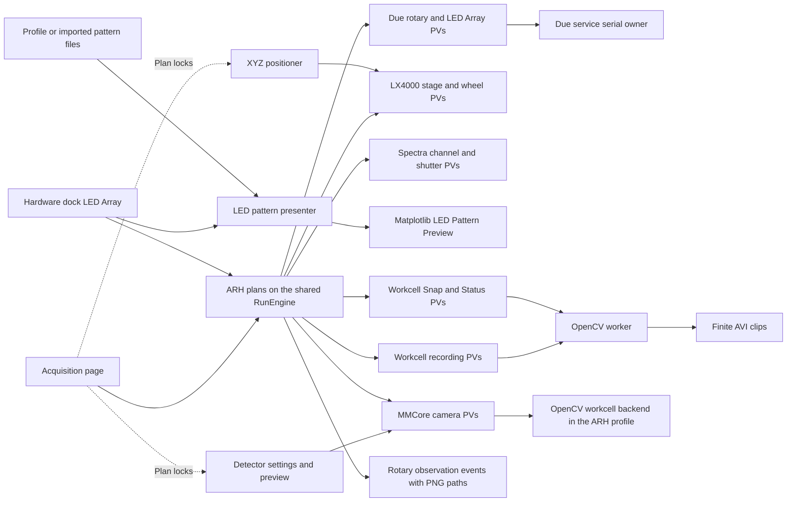

# AHT architecture

AHT composes instruments from Redsun profiles. A FastCS service owns each
hardware connection and exposes device controls and readbacks over PVAccess.
Ophyd-async clients expose those signals to Bluesky plans and presenters.

## Instrument profiles

| Selector | Devices |
|---|---|
| `holospim` | ESP300 survey XYZ, FLIR via Spinnaker, PVCAM via MMCore, plus the ESP32-S3 MCU for X28 fast Z, LED illumination and rotation |
| `arh` | ASI LX4000 XYZ, FLIR via Spinnaker, Lumencor Spectra via MMCore, and Arduino Due via unified EMMSH |

The [README](../README.md#run) shows how to check either profile in mock mode
and layer in host settings. Both profiles build headless device sessions.
The camera and DPCT GUI sessions have separate entry points.

The HoloSPIM Hardware dock binds the profile's attached AAAOTF device to
laser presets, an All Off action and RF settings. Service readbacks populate
the status display. Button requests follow
`Hardware → AcquisitionPresenter → RunEngine → AttachedAAAOTF → persistent PVA service`.
The service retains ownership of its MMCore connection. See the
[AAAOTF setup and controls](aaaotf.md).

## LED pattern preview

The ARH and HoloSPIM desktops include a Matplotlib LED Pattern Preview dock.
Launch HoloSPIM with `aht session holospim --profile PATH`, or omit the path for its
packaged mock profile. ARH uses its existing `aht session arh` entry point.
The `pyqt` and `pyside` extras include Matplotlib.

The dock shows a diagnostic graded semicircle at startup. Open a JSON file
containing one 8-bit integer per hardware LED to inspect a pattern without
sending it to the instrument. To preload such files, set
`presenters.led_pattern_ctrl.sources` to a list of filenames in the profile.
Relative filenames resolve beside that profile. The ARH dock also receives
the last successful Hardware dock static-map upload. Firmware slots uploaded
by other tools cannot be reconstructed from the controller's slot bitmask.
The plot labels indices and units. Ring start angles and wiring order remain
schematic until measured on the panel.

## Due dynamic LED uploads

The ARH headless client can call
`await due.upload_dynamic_pattern(slot, pixels)` with a slot from 1 to 5 and
61 bytes in hardware LED order. The client uses the existing LED Array request
on the Due FastCS service. The service holds its serial lock until the complete
map is committed and returns a correlated receipt with the generation, firmware
CRC-32 and host SHA-256. Uploads do not display the map. The slots are volatile.
The desktop's existing static-map upload continues to display its selected map.

In the ARH desktop, the **Hardware → LED Array → Run dynamic DPCT demo**
control selects an idle MMCore camera. The plan shows the graded and solid
semicircles, then groups 1–4 graded and groups 1–4 solid. Each of the ten
patterns is displayed for three seconds before the software snap. The plan
records frames and pattern provenance through the normal acquisition path.
The Due FastCS service validates readiness and forwards the frame ACK only
after the plan acquires and stores the frame. The plan blanks on exit.

For stationary headless software snaps, the exclusive serial owner can also
use `UnifiedMcu.identify(due=True)` and `dynamic_shots` with published slot
receipts. The shared protocol also supports the ESP32-S3's 91-LED panel
through `UnifiedMcu.identify()`, `upload_dynamic_pattern` and
`dynamic_shots` on the exclusive serial owner. The desktop button described
above uses the ARH Due service and its native masks.

## Acquisition and storage

```text
FastCS service → ophyd-async device → Bluesky plan → RunEngine documents
                                                        ├─ preview events
                                                        └─ stream asset references
```

| Source area | Role |
|---|---|
| `configurations/`, `profiles/` | CLI dispatch, service selection and session wiring |
| `services/`, `device/`, `robotic/` | Service owners, PVA clients and instrument-specific adapters |
| `contracts/`, `plans/` | Acquisition requests, frame and run identity, and plan orchestration |
| `presenter/`, `view/` | Run-document routing, detector controls and image display |
| `storage/` | Zarr frame storage, manifests and plane receipts |
| `dpct_tiff.py`, `idt_tiff.py`, `scientific/reconstruction/` | Offline TIFF loading, DPCT and linear IDT kernels, and output provenance |

## Offline DPCT reconstruction



```console
aht reconstruct-tiff --solver dpct --sample sample.tif --reference background.tif --config reconstruction.yaml --output ri.tif
```

The sample must declare `ZCYX` with four illumination channels. The matched
background can declare `CYX` for a broadcast reference, `TCYX` for a per-shot
median over repeats, or `ZCYX` for one reference per plane. Supply a legacy DPCT
YAML directly or export the schema
version 1 form with `aht migrate-recon-config --solver dpct --input legacy.yaml
--output reconstruction.yaml`. Set `--roi Y,X,HEIGHT,WIDTH` to select the same
zero-based region in both TIFFs. DPCT supports `--method tikhonov` and `--method tv`.
The method and tile geometry can also come from the YAML. Override tile size with
`--tile-size HEIGHT,WIDTH`. Legacy migration preserves the effective TV weight
used by the legacy 3D solver. In native YAML, `dpct_tv_weight`, `dpct_admm_rho`,
and `dpct_tv_iterations` explicitly control the solve.

Normalization rejects zero-valued sample or reference pixels by default. Use
`--zero-policy neutral` to replace their ratios with 1. The JSON provenance
records how many values were replaced, input and output SHA-256 digests,
optical settings and the tile layout.

Both NumPy and CuPy run offline. Install the `gpu-cupy` extra for CUDA 12 and
select `--backend cupy --gpu-id 0` to use a GPU. Scratch files are created beside
the output. DPCT writes an ImageJ `ZYX` TIFF in legacy `uint16` RI × 10,000
encoding by default. Use `--output-dtype float32` for absolute RI. Both solvers
refuse existing output or provenance files. The DPCT transfer functions and tiler come from AHT
revision `cbc0b4ed4d1c4c0d04afedcd6106e38fbf234e4c`.

## Offline linear IDT reconstruction

```console
aht reconstruct-tiff --solver idt --sample sample.tif --reference repeats.tif --config idt.yaml --backend cupy --median-output median.tif --output ri.tif
```

IDT expects a single-focus `CYX` sample and a matching `CYX` reference or
`TCYX` repeats. The optional `--median-output` writes the exact per-shot reference
in float32, beside the reconstruction. The float32 reconstruction contains
absolute RI evaluated at the model defocus values in the provenance JSON.
The illumination file must follow the TIFF channel order. Named sample and
reference channels must agree. IDT also checks its calibration LED indices when
the TIFFs and calibration supply them. Paths in YAML are
relative to the YAML file. Install `offline-idt` for HDF5 and MATLAB calibration
imports and the optional detector taper.

```yaml
schema_version: 1
optics:
  wavelength_um: 0.465
  pixel_size_um: 0.18333333333333332
  pixel_size_z_um: 0.25
  numerical_aperture: 0.95
  refractive_index_medium: 1.35
idt:
  illumination_file: ordered_led_directions.mat
  depth_range_um: [-3, 3]
  regularization_phase: 2
  regularization_absorption: 100
```

Use `na_list` in a MAT file for wavelength-independent directions or ordered
`(fx, fy)` in cycles per micrometre in `.npy` or `illumination_fxy` in `.npz`.
An HDF5 file with `Sorted_Pos` uses `illumination_geometry_na` to convert positions,
with a default of 0.9. Keep `legacy_led_rotation: false` when the calibration
has already been ordered in the reconstruction coordinate system. The pupil NA
is independently specified in `optics`. An optional
`background_footprint_fraction` rejects pixels that are below that fraction of
their shot median in any reference shot. `background_taper_px` applies a Gaussian
taper of the selected footprint. `--zero-policy` controls zero-valued ratios
inside the usable footprint.

## Acquisition and live preview

Live preview follows per-detector Events from the run. The camera service can
write frames directly, and software DPCT writes frames by illumination pattern.
`RunFrameStore` records frame checksums and preserves partial captures. Frame
counts and host-ordered associations do not establish exposure timing.

The experimental stack and time-lapse paths coordinate camera capture,
illumination and motion through the selected service owners. The Due service
exposes commanded rotary counts, stop and LED blanking. Calibrate physical
axes, shutter behavior and trigger timing on each setup before use.

## Testing

Use the [Windows headless runner](../scripts/dsh/README.md) for pytest. The suite
uses synthetic inputs, fake backends and loopback PVAccess. Keep GUI windows
and physical devices out of headless checks.

## HoloSPIM desktop session



The survey service requires the axis identities and configured travel bounds
for all three axes. It issues sequential moves and uses controller encoder
readback. An explicit stop latches the service until restart after
reconciliation. RunEngine cleanup checks for an unresolved move on the
touched axis before sending a stop, so completed acquisitions leave the
survey stage available for the next bounded operation.

The desktop routes survey XYZ, roll and the optional X28 axis through the
Positioner. The
`holospim_led_blank` acquisition action blanks the panel through the MCU
service. The LED pattern preview displays files without sending commands.
The `holospim_laser_profile` action offers **All Off**, **488 nm**, and
**561 nm** through the attached AAAOTF service. See the
[laser service instructions](aaaotf.md).
Acquisition device locks also disable the corresponding detector, positioner
and ROI controls.

HoloSPIM's survey stack, X28 stack, dynamic DPCT and hand-eye capture check
that the selected camera reports both an idle service and internal trigger
mode before starting acquisition.

`holospim_survey_z_stack` captures internal-trigger frames at bounded ESP300
Z positions and returns Z to its starting position after a successful run.
Select the camera and confirm the optical setup before running. The plan
records the ordered frame count and controller Z reading for each plane.

For HoloSPIM roll motion, configure the MCU service's `roll-bounds-steps`
with the commissioned lower and upper counter values. The service checks
both the reported counter and the target. Re-zeroing changes the reference
for those limits and is refused while they are configured.

`holospim_x28_readback` records the controller-reported position, target,
speed, position error and drive flags without commanding motion.

The unified MCU service accepts X28 point-move requests only when the host
configures `x28-jog-bounds-tenths` and requires HoloSPIM panel capabilities.
The service checks its own bounds and refuses point moves during a reservation.
It verifies zero reported speed, valid drive flags and target and position
within one controller count for at least 150 ms before reporting settlement.
The client can cancel a matching move by request ID. When motion may have
started, cancellation requests a controller stop and quarantines the owner.
Physical stop remains unverified. The endpoint takes controller tenths of a
degree. The optional X28 Positioner row uses micrometres and requires both
`x28_um_per_turn` and `x28_jog_bounds_tenths` on the MCU device. The signed
scale sets the direction. Use the same angular bounds on the device and the
service. When adding these settings in an overlay, repeat the MCU device's
`plugin_name`, `plugin_id`, and `service` fields. The live profile check
requires matching bounds and verifies that the configured range and maximum
point move fit the 1 mm envelope at the supplied scale. Keep the row disabled
on the instrument until the linear travel and stop checks are complete.

In the foreground Positioner, hold A to jog. The left stick controls survey
X/Y, and the vertical D-pad controls survey Z. The horizontal D-pad controls
X28 when its row is configured. The right stick controls roll in mock
sessions or when the live overlay sets `enable_controller_jog` on the
rotation device and supplies the commissioned service `roll-bounds-steps`.
Releasing A, disconnecting the controller, losing foreground focus, or
locking a jog device for acquisition requests a stop for any unsettled jog.

Set `presenters.holospim_ctrl.x28_bounds_tenths` in the host overlay to expose
`holospim_x28_software_stack`. Limits and requested positions are in tenths
of a degree at the X28 controller. Select a camera configured for internal
trigger and confirm camera, illumination and travel readiness. The plan holds
camera, survey and roll controls, disables MCU trigger pulses, and records a
separate store per plane. A successful run leaves the LEDs blank, pulses
disabled and X28 at the final plane.

Set `presenters.holospim_ctrl.enable_x28_triggered_stack` to expose
`holospim_x28_triggered_stack` with the configured X28 bounds. This plan
requires FLIR FrameStart, Line0 and FallingEdge readbacks before enabling
GPIO13 camera pulses. It writes one continuous capture and reconciles
stored frames with the camera count and MCU pulse-attempt count.
Frame-to-plane association follows host order. A successful run blanks
illumination, disables automatic pulses and leaves X28 at the last plane.

The `holospim_dynamic_dpct` plan is available when
`presenters.holospim_ctrl.enable_dynamic_dpct` is enabled. Supply a JSON file
containing one to five arrays of 91 integer weights from 0 to 255, in panel
index order. The camera must be configured for internal trigger. The run
saves a frame store and recipe hashes. Each frame event records the
zero-based store index, camera service count, slot, generation and CRC.
The run marks the association as inferred from host snap order.

The `holospim_hand_eye_preview` action exports a signed XYZ/roll path for
simulator review. Zero omits an axis. Set `hand_eye_roll_limits_deg` in the
presenter configuration to include roll and enter the parked X28 simulator
coordinate in millimetres. The action reads the current anchor without
moving the devices or taking frames.

`holospim_hand_eye_capture` takes the preview and its sampled simulator
review. After operator confirmation it checks the current anchor and limits,
captures the designated waypoints and records before/after positions in the
camera store. The roll reading is the controller's step counter.

## ARH desktop session

Run `aht session arh --profile PATH` with the ARH instrument profile supplied by
the instrument checkout. The profile owns device identity, service endpoints,
commissioning bounds and mock mode. Use the Qt extra and the instrument's
startup recipe for an operator session.



The Hardware dock shows LED Array controls when the Due service detects the
compact LED protocol. Enable discovery using the service's `--led-array` option.
Pattern, pixel, L4, PWM, color, intensity and blanking requests go through the
shared RunEngine and the Due service. To load a static map, select a JSON file
containing a single array of integers from 0 to 255, one per physical pixel in
zero-based order. The service stages and commits the whole map over the same
serial connection. The map is volatile and should be loaded after startup.

The acquisition page provides typed controls for channel, shutter, wheel slot,
and absolute Due roll, pitch and yaw targets. The Due service must explicitly
enable bounded rotary targets. They are commanded steps. XYZ jogs and absolute
moves use the positioner and the LX4000 service's commissioning limits.

The optional `workcell-webcam` service uses the `camera-webcam` extra. It
exposes independent Start, Finish and Status PVs for sample-handler monitoring.
Each recording runs in its own OpenCV process and writes an MJPEG AVI clip
directly to the configured output directory. The service starts idle and opens
the video source on request. The `workcell_record` plan starts recording through
the service and reports the AVI path. The ARH profile instead uses an OpenCV
backend for the MM camera PV contract by default. Select `workcell` alongside
the microscope cameras in the `live_stream` **Detectors** field. This backend
publishes 1920 × 1080 Mono8 frames, supports software ROI, and reports exposure
as unavailable because the backend does not expose it in milliseconds. The
optional legacy recorder profile replaces the OpenCV streaming service to keep
one owner of the physical webcam.

With both Due and workcell devices configured, `workcell_rotary_check` captures
three workcell stills around a rotary round trip. The default is one controller
count. Angular requests up to 10 degrees use an explicit per-axis count scale.
Each event pairs its PNG path with the phase and Due commanded-step readback.
The operator confirms clearance and chooses an enabled axis with room inside
its service limits.

`lx4000_z_stack` begins at the current LX4000 Z coordinate, settles and checks
readback, then software-snaps the selected idle MMCore camera. It records
host-ordered plane metadata and writes a separate Zarr frame store. The
operator confirms exclusive software-snap use and sets illumination before
launch. The stack is bounded to 32 planes and 1 mm total span, additionally
subject to the service limits, and leaves Z at the last target. This is the
LX4000 stack path. Due ZDT hardware-triggered stacks require a qualified
controller/session binding.

`arh_dpct` checks the Due service's opt-in software DPCT capability, blanks
the panel, and then selects each of its four non-triggering patterns before
software-snapping the selected camera. The plan checks frame counts and
records pattern commands and frame indices with the store. It blanks the
panel during cleanup. The separate `dpct` entry is for a declared legacy
four-pattern LED device with its own matching service.
