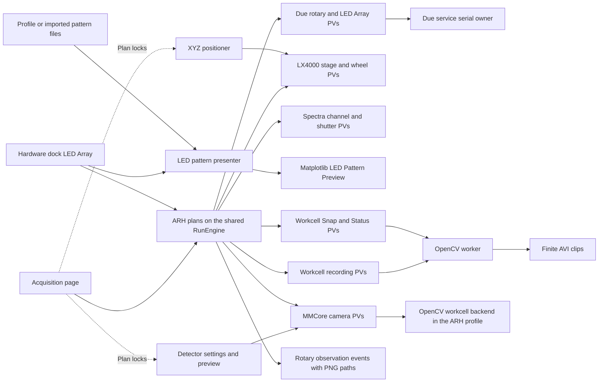

# AHT architecture

AHT composes instruments from Redsun profiles. A FastCS service owns each
hardware connection and exposes device controls and readbacks over PVAccess.
Ophyd-async clients expose those signals to Bluesky plans and presenters.

## Instrument profiles

| Selector | Devices |
|---|---|
| `holospim` | MMCore camera and survey stage, plus the ESP32-S3 MCU for X28 fast Z, LED illumination and rotation |
| `arh` | ASI LX4000 XYZ, FLIR via Spinnaker, Lumencor Spectra via MMCore, and Arduino Due via unified EMMSH |

The [README](../README.md#run) shows how to check either profile in mock mode
and layer in host settings. Both profiles build headless device sessions.
The camera and DPCT GUI sessions have separate entry points.

## LED pattern preview

The ARH and HoloSPIM desktops include a Matplotlib LED Pattern Preview dock.
Launch HoloSPIM with `aht session holospim --profile PATH`, or omit the path for its
packaged mock profile. ARH uses its existing `aht session arh` entry point.
The `pyqt` and `pyside` extras include Matplotlib.

The dock shows a diagnostic graded semicircle at startup. Open a JSON file
containing one 8-bit integer per hardware LED to inspect a pattern without
sending it to the instrument. To preload such files, set
`presenters.led_pattern_ctrl.sources` to a list of filenames in the profile.
Relative filenames resolve beside that profile. The ARH dock also receives
the last successful Hardware dock static-map upload. Firmware slots uploaded
by other tools cannot be reconstructed from the controller's slot bitmask.
The plot labels indices and units. Ring start angles and wiring order remain
schematic until measured on the panel.

## Due dynamic LED uploads

The ARH headless client can call
`await due.upload_dynamic_pattern(slot, pixels)` with a slot from 1 to 5 and
61 bytes in hardware LED order. The client uses the existing LED Array request
on the Due FastCS service. The service holds its serial lock until the complete
map is committed and returns a correlated receipt with the generation, firmware
CRC-32 and host SHA-256. Uploads do not display the map. The slots are volatile.
The desktop's existing static-map upload continues to display its selected map.

In the ARH desktop, the **Hardware → LED Array → Run dynamic DPCT demo**
control selects an idle MMCore camera. The plan shows the graded and solid
semicircles, then groups 1–4 graded and groups 1–4 solid. Each of the ten
patterns is displayed for three seconds before the software snap. The plan
records frames and pattern provenance through the normal acquisition path.
The Due FastCS service validates readiness and forwards the frame ACK only
after the plan acquires and stores the frame. The plan blanks on exit.

For stationary headless software snaps, the exclusive serial owner can also
use `UnifiedMcu.identify(due=True)` and `dynamic_shots` with published slot
receipts. The shared protocol also supports the ESP32-S3's 91-LED panel
through `UnifiedMcu.identify()`, `upload_dynamic_pattern` and
`dynamic_shots` on the exclusive serial owner. The desktop button described
above uses the ARH Due service and its native masks.

## Acquisition and storage

```text
FastCS service → ophyd-async device → Bluesky plan → RunEngine documents
                                                        ├─ preview events
                                                        └─ stream asset references
```

| Source area | Role |
|---|---|
| `configurations/`, `profiles/` | CLI dispatch, service selection and session wiring |
| `services/`, `device/`, `robotic/` | Service owners, PVA clients and instrument-specific adapters |
| `contracts/`, `plans/` | Acquisition requests, frame and run identity, and plan orchestration |
| `presenter/`, `view/` | Run-document routing, detector controls and image display |
| `storage/` | Zarr frame storage, manifests and plane receipts |

Live preview follows per-detector Events from the run. The camera service can
write frames directly, and software DPCT writes frames by illumination pattern.
`RunFrameStore` records frame checksums and preserves partial captures. Frame
counts and host-ordered associations do not establish exposure timing.

The experimental stack and time-lapse paths coordinate camera capture,
illumination and motion through the selected service owners. The Due service
exposes commanded rotary counts, stop and LED blanking. Calibrate physical
axes, shutter behavior and trigger timing on each setup before use.

## Testing

Use the [Windows headless runner](../scripts/dsh/README.md) for pytest. The suite
uses synthetic inputs, fake backends and loopback PVAccess. Keep GUI windows
and physical devices out of headless checks.

## ARH desktop session

Run `aht session arh --profile PATH` with the ARH instrument profile supplied by
the instrument checkout. The profile owns device identity, service endpoints,
commissioning bounds and mock mode. Use the Qt extra and the instrument's
startup recipe for an operator session.



The Hardware dock shows LED Array controls when the Due service detects the
compact LED protocol. Enable discovery using the service's `--led-array` option.
Pattern, pixel, L4, PWM, color, intensity and blanking requests go through the
shared RunEngine and the Due service. To load a static map, select a JSON file
containing a single array of integers from 0 to 255, one per physical pixel in
zero-based order. The service stages and commits the whole map over the same
serial connection. The map is volatile and should be loaded after startup.

The acquisition page provides typed controls for channel, shutter, wheel slot,
and absolute Due roll, pitch and yaw targets. The Due service must explicitly
enable bounded rotary targets. They are commanded steps. XYZ jogs and absolute
moves use the positioner and the LX4000 service's commissioning limits.

The optional `workcell-webcam` service uses the `camera-webcam` extra. It
exposes independent Start, Finish and Status PVs for sample-handler monitoring.
Each recording runs in its own OpenCV process and writes an MJPEG AVI clip
directly to the configured output directory. The service starts idle and opens
the video source on request. The `workcell_record` plan starts recording through
the service and reports the AVI path. The ARH profile instead uses an OpenCV
backend for the MM camera PV contract by default. Select `workcell` alongside
the microscope cameras in the `live_stream` **Detectors** field. This backend
publishes 1920 × 1080 Mono8 frames, supports software ROI, and reports exposure
as unavailable because the backend does not expose it in milliseconds. The
optional legacy recorder profile replaces the OpenCV streaming service to keep
one owner of the physical webcam.

With both Due and workcell devices configured, `workcell_rotary_check` captures
three workcell stills around a rotary round trip. The default is one controller
count. Angular requests up to 10 degrees use an explicit per-axis count scale.
Each event pairs its PNG path with the phase and Due commanded-step readback.
The operator confirms clearance and chooses an enabled axis with room inside
its service limits.

`lx4000_z_stack` begins at the current LX4000 Z coordinate, settles and checks
readback, then software-snaps the selected idle MMCore camera. It records
host-ordered plane metadata and writes a separate Zarr frame store. The
operator confirms exclusive software-snap use and sets illumination before
launch. The stack is bounded to 32 planes and 1 mm total span, additionally
subject to the service limits, and leaves Z at the last target. This is the
LX4000 stack path. Due ZDT hardware-triggered stacks require a qualified
controller/session binding.

`arh_dpct` checks the Due service's opt-in software DPCT capability, blanks
the panel, and then selects each of its four non-triggering patterns before
software-snapping the selected camera. The plan checks frame counts and
records pattern commands and frame indices with the store. It blanks the
panel during cleanup. The separate `dpct` entry is for a declared legacy
four-pattern LED device with its own matching service.
